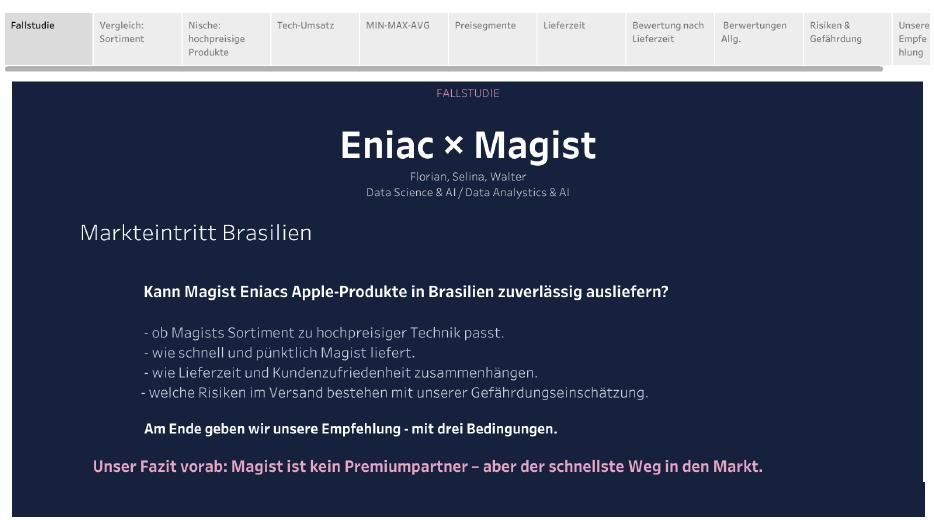

# Eniac × Magist: Markteintritt Brasilien

Fallstudie aus der Weiterbildung Data Science & AI. Ein Online-Händler prüft,
ob er für die Expansion nach Brasilien mit einem lokalen Logistikdienstleister
zusammenarbeiten soll. Grundlage ist ein Auszug aus dessen Datenbank mit rund
100.000 Bestellungen.

Auftraggeber war die Geschäftsführung. Das Ergebnis wurde als
Entscheidungsvorlage vor dem CEO präsentiert, in vier Minuten, mit
anschließender Fragerunde.

> Eniac und Magist sind fiktive Unternehmen, die Rolle des CEO wurde im Rahmen
> der Übung besetzt. Es handelt sich um eine Fallstudie, nicht um eine reale
> Geschäftsbeziehung.

**[→ Interaktive Präsentation auf Tableau Public](https://public.tableau.com/views/fallstudie1magist/Prsentation)**
· [Als PDF ansehen](presentation/eniac-magist-praesentation.pdf)

[](https://public.tableau.com/views/fallstudie1magist/Prsentation)

---

## Die Ausgangslage

Eniac ist ein spanischer Online-Marktplatz für Apple-Produkte und hochwertiges
Zubehör. Nach dem Börsengang drängen Investoren auf Wachstum, der Vorstand will
innerhalb eines Jahres nach Brasilien.

Eine eigene Lieferkette aufzubauen dauert deutlich länger. Magist ist ein
brasilianisches SaaS-Unternehmen und bietet Auftragsmanagement, Lagerhaltung,
Versand und Kundenservice an. Eniac würde weiterhin über die eigene Website und
unter eigener Marke verkaufen, Magist übernimmt die Abwicklung im Hintergrund.

Im Unternehmen gibt es zwei Bedenken:

1. Eniac verkauft hochwertige Technik. Ist Magist dafür der richtige Partner?
2. Schnelle Lieferung ist Teil des Markenversprechens. Liefert Magist schnell
   genug?

Meine Aufgabe war, beide Fragen aus den Daten zu beantworten und der
Geschäftsführung eine Empfehlung vorzulegen.

---

## Ergebnis

**Empfehlung: Vertrag abschließen, aber mit drei Bedingungen.**

| Bedingung | Begründung |
|---|---|
| Start im Südosten | Dort liegt die Verspätungsquote bei 5 bis 6 Prozent, im Norden bei fast 20 |
| Lieferzeit vertraglich fixieren | Maximal 10 Tage im Zielgebiet. Die Daten zeigen, dass Magist das inzwischen schafft |
| Laufzeit auf 18 Monate kürzen | Drei Jahre sind zu lang für einen Markttest |

Die Begründung in einem Satz: Magist ist kein Premiumpartner, aber der schnellste
Weg in den Markt.

---

## Was die Daten zeigen

### Produktpassung

Technik macht gut ein Fünftel der verkauften Artikel aus. Entscheidend ist aber
die Preisverteilung.

| Preisklasse | Anteil der Tech-Artikel |
|---|---|
| unter 50 € | 42,8 % |
| 50 bis 100 € | 19,7 % |
| 100 bis 200 € | 23,2 % |
| 200 bis 500 € | 9,4 % |
| ab 500 € | **4,9 %** |

Eniacs Preissegment liegt bei knapp fünf Prozent. Diese fünf Prozent
erwirtschaften allerdings ein Drittel des gesamten Technikumsatzes.

Besonders deutlich wird es bei der Kategorie Computer, also Eniacs Kerngeschäft:
203 verkaufte Artikel in 25 Monaten, bei einem Durchschnittspreis von 1.098 Euro.
Das Segment existiert, es ist nur sehr klein.

### Lieferzeit

| Kennzahl | Wert |
|---|---|
| Durchschnitt über den gesamten Zeitraum | 12 Tage |
| Februar 2018 | 17 Tage |
| August 2018 | 7,7 Tage |
| Lieferungen binnen 7 Tagen | 27 % |
| Verspätet gegenüber Zusage | 8,1 % |
| Erfolgreich zugestellt | 97,0 % |

Der Gesamtdurchschnitt von 12 Tagen beschreibt einen Zustand, den es nicht mehr
gibt. Die Lieferzeit hat sich innerhalb von sechs Monaten halbiert, bei
gleichbleibendem Bestellvolumen.

### Lieferzeit und Zufriedenheit

| Bewertung | Durchschnittliche Lieferdauer |
|---|---|
| 1 Stern | 21,4 Tage |
| 2 Sterne | 16,7 Tage |
| 3 Sterne | 14,3 Tage |
| 4 Sterne | 12,3 Tage |
| 5 Sterne | 10,7 Tage |

Eine pünktliche Lieferung erhält im Schnitt 4,29 Sterne, eine verspätete 2,55.
Eine einzige Verspätung kostet also rund 1,7 Sterne. Das ist der Grund, warum
die Lieferzeit für Eniac kein Logistikthema ist, sondern ein Markenthema.

---

## Inhalt des Repositories

```
sql/            Abfragen gegen die Magist-Datenbank
data/raw/       Die vollständige Datenbank als CSV, neun Tabellen
data/           Aggregierte Ergebnisse, Grundlage der Diagramme
presentation/   Präsentation als PDF
notes/          Ausführliche Analyseergebnisse
```

### sql/

| Datei | Inhalt |
|---|---|
| `01_datenerkundung.sql` | Erste Orientierung: Umfang, Zeitraum, Bestellstatus, Sortiment, Preisspanne |
| `02_business_questions.sql` | Die eigentliche Analyse zu Produkten, Verkäufern und Lieferzeiten |

Beide Dateien laufen gegen MySQL 8 und beginnen mit `USE magist;`. Die Ergebnisse
stehen als Kommentar unter den jeweiligen Abfragen.

### data/

In `raw/` liegen die neun Tabellen der vollständigen Datenbank als CSV, rund
450.000 Datensätze. Damit lassen sich alle Abfragen nachvollziehen und eigene
anschließen. Die Beziehungen zwischen den Tabellen sind in
[`data/README.md`](data/README.md) beschrieben.

Daneben liegen die aggregierten Tabellen, aus denen die Diagramme entstanden
sind. Semikolon als Trennzeichen, Komma als Dezimaltrennzeichen.

### Datenbank lokal aufsetzen

```bash
mysql -u root -p -e "CREATE DATABASE magist;"
```

Danach die CSVs aus `data/raw/` importieren, etwa über den Import Wizard in
MySQL Workbench. Die Skripte in `sql/` beginnen mit `USE magist;` und laufen
dann durch.

---

## Vorgehen

Der Weg von der Geschäftsfrage zur Aussage lief in vier Schritten:

**1. Geschäftsfrage übersetzen.** „Passt Magist zu uns" ist noch keine Abfrage.
Daraus wurde: Welche Produktkategorien gibt es, wie verteilen sich die Preise,
wie groß ist der Anteil hochpreisiger Technik.

**2. Annahmen festlegen.** Mehrere Fragen erforderten eigene Entscheidungen. Die
wichtigsten sind unten dokumentiert, weil sie die Zahlen direkt beeinflussen.

**3. Abfragen und prüfen.** Nach jeder Abfrage zwei Kontrollen: Passt die
Größenordnung zur Frage, und erfüllt jede Zeile wirklich die Bedingung. Eine
fehlerfrei laufende Abfrage ist noch kein richtiges Ergebnis.

**4. Visualisieren und zuspitzen.** In Tableau entstanden explorative Diagramme
zum Verstehen und daraus wenige erklärende Diagramme für die Präsentation. Jedes
Diagramm trägt genau eine Aussage, und die steht im Titel.

**5. Auf die Zielgruppe zuschneiden.** Zuhörer war die Geschäftsführung, nicht
das Datenteam. Entsprechend steht die Empfehlung am Anfang und nicht am Ende,
die Zahlen sind gerundet, und methodische Details kamen nur auf Nachfrage zur
Sprache. Für die Fragerunde waren Antworten zu den strittigen Punkten
vorbereitet, etwa zur Abgrenzung der Technikkategorien und zur Frage, warum
der aktuelle Lieferzeitwert aussagekräftiger ist als der Gesamtdurchschnitt.

---

## Getroffene Annahmen

Mehrere Fragen ließen sich nur mit eigenen Festlegungen beantworten. Sie stehen
hier, damit die Zahlen nachvollziehbar und überprüfbar bleiben.

**Was als Technik zählt.** Zehn Kategorien: `computers`,
`computers_accessories`, `electronics`, `telephony`, `fixed_telephony`,
`tablets_printing_image`, `audio`, `consoles_games`, `pc_gamer`, `watches_gifts`.

`watches_gifts` ist bewusst dabei, weil Smartwatches zu Eniacs Sortiment gehören.
Die Kategorie enthält allerdings auch klassische Uhren. Ohne sie läge der
Technikanteil bei 15,3 statt 20,6 Prozent.

Haushaltsgeräte und Medien zählen nicht mit, da sie nicht zu Eniacs Segment
gehören.

**Was als teuer gilt.** Ab 500 Euro. Das 99. Perzentil aller verkauften Artikel
liegt bei 890 Euro, 500 Euro entspricht etwa Eniacs Einstiegspreis.

**Der Zeitraum.** Der Datensatz umfasst 25 Monate von September 2016 bis Oktober
2018. Vier Randmonate sind praktisch leer, November 2016 fehlt ganz. Belastbar
wären 20 Monate. Gerechnet wurde mit 25, was die vorsichtigere Variante ist, weil
sie niedrigere Monatsdurchschnitte ergibt.

---

## Was die Daten nicht beantworten

Die Zahlen beschreiben Magists bisherige Kunden, also überwiegend kleine und
mittlere brasilianische Händler mit günstigen Alltagsprodukten. Eniac wäre ein
anderer Kundentyp mit anderer Preisklasse und anderer Erwartungshaltung.

Ob Magists Logistik auch bei teurer, diebstahlgefährdeter Elektronik funktioniert,
lässt sich aus 203 Computerverkäufen nicht ableiten. Genau deshalb steht in der
Empfehlung die kürzere Vertragslaufzeit.

---

## Verwendete Werkzeuge

MySQL 8 und MySQL Workbench für die Abfragen, Tableau Public für die
Visualisierung, Git und GitHub für die Versionierung.

Die Präsentation ist als Tableau Story aufgebaut und
[öffentlich einsehbar](https://public.tableau.com/views/fallstudie1magist/Prsentation).
Die Diagramme sind dort interaktiv, Tooltips zeigen die Werte je Datenpunkt.

---

## Kontext

Teil der Weiterbildung Data Science & AI. Die Fallstudie wurde in einer
Dreiergruppe bearbeitet und gemeinsam vor dem CEO präsentiert, mit einem festen
Zeitfenster von vier Minuten und anschließender Fragerunde.

Dieses Repository enthält meine Analyse und Dokumentation.
